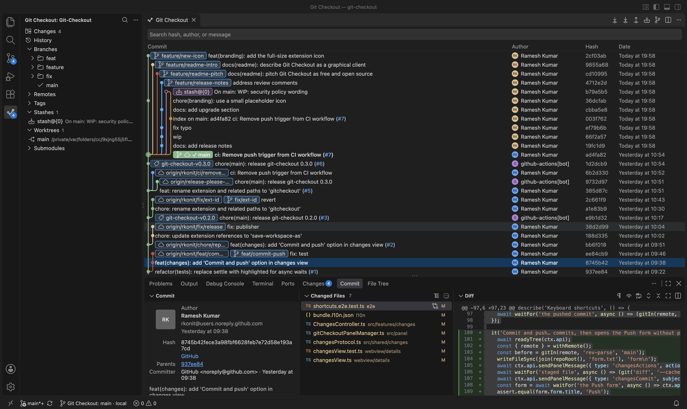

# Git Checkout

A graphical Git client for VS Code. See your history as a graph, stage and commit changes, and handle branches, tags, stashes, worktrees, submodules, rebases and merge conflicts without leaving the editor. It uses VS Code's own look and keys.

Git Checkout runs on the **workspace** side, so Git always runs on the same machine as your folder: local, WSL, SSH, Dev Containers or Codespaces.

## Features

- **Commit graph:** search, filter by the active branch, jump to HEAD, hide stashes, remote branches or tags, and show the reflog. The search takes filters: `author:ada`, `path:src/app.ts`, `since:2024-01-01`, `until:2024-06-30` and `content:text` (commits that add or remove that text) and `regex:pattern` (commits with a changed line that matches the pattern), alone or with words to look for.
- **Background fetch:** every open repository is fetched on a timer, so the graph shows what others pushed. It waits while the window is in the background or a merge or rebase is in progress, and it never asks for a password.
- **Changes:** stage, unstage and discard files, whole hunks, or just the lines you select in the diff (drag over them, or click line numbers; in a side-by-side diff a drag stays on one side), commit, amend, and commit and push, with inline diffs.
- **Branches, tags and remotes:** create, check out, rename, delete, merge, rebase, fast-forward, compare, and set upstreams.
- **Clone:** clone a repository into a folder you choose, with a progress notification you can cancel.
- **Fetch, pull and push:** a form for the options, or Quick Fetch, Quick Pull and Quick Push for the tracked remote.
- **Stashes, worktrees and submodules:** save, apply, pop and drop stashes; add, open and delete worktrees; initialize, update and sync submodules.
- **History tools:** file, folder and hunk history, a blame view that shows who last changed each line of a commit's change, cherry-pick, revert, reset, patches, archives (zip or tarball of any commit, branch or tag), and bisect.
- **Housekeeping:** prune stale remote-tracking branches, delete merged branches, clean untracked files, sparse checkout, garbage collection, and repository statistics, all from Quick Launch.
- **Pull requests:** open GitHub's new pull request page for a branch.
- **Interactive rebase and merge conflicts:** reorder, squash, fix up, reword and drop commits; resolve conflicts in one place.
- **Git Flow and commit signing.**
- **Quick Launch:** one list of every repository action, plus your own commands.
- **Keyboard shortcuts** for every common action, which you can turn off or rebind.

## Requirements

- VS Code 1.90 or newer.
- The built-in **Git** extension turned on. Do not set `git.enabled` to false; Git Checkout uses it for credentials and `git.path`.
- A Git installation on the machine that holds your folder.

## Getting started

1. Open a folder that is a Git repository.
2. Click the Git Checkout icon in the Activity Bar, or run **Git Checkout: Open** from the Command Palette.
3. Press **Ctrl+P** (**Cmd+P** on macOS) while a Git Checkout view has focus to run any action.

To clone, press **Ctrl+N** (**Cmd+Shift+N**), choose **Clone Repository…** in the empty sidebar, or run **Clone…** from Quick Launch.

## Settings

| Setting | Default | What it does |
| --- | --- | --- |
| `gitCheckout.shortcuts.enabled` | on | Turns the Git Checkout keyboard shortcuts on or off. |
| `gitCheckout.graph.order` | `date` | Commit order in the graph. |
| `gitCheckout.graph.showStashes` | on | Show stashes in the graph. |
| `gitCheckout.graph.showRemoteBranches` | on | Show remote-tracking branches in the graph. |
| `gitCheckout.graph.showTags` | on | Show tags in the graph. |
| `gitCheckout.graph.showReflog` | off | Show commits that only the reflog reaches. A repository can override this. |
| `gitCheckout.fetch.includeTags` | off | Fetch all tags on every fetch and auto-fetch. |
| `gitCheckout.commit.pushAfterCommit` | off | Push after every commit from the Changes view (not after an amend). |
| `gitCheckout.commit.subjectWarningLength` / `subjectLengthLimit` | 50 / 70 | Hint and mark when the commit subject is longer; 0 turns it off. |
| `gitCheckout.checkout.updateSubmodules` | on | Update submodules after a checkout. |
| `gitCheckout.clone.defaultFolder` | empty | Folder Clone Repository starts in. |
| `gitCheckout.branch.rememberCheckout` | on | Create Branch remembers whether it last checked out the new branch. |
| `gitCheckout.diff.syntaxHighlighting` / `changeMarks` | on / on | Color code in diffs; show + and − beside changed lines. |
| `gitCheckout.graph.compactBranchLabels` | on | Show a branch and its remote-tracking branches as one label. |
| `gitCheckout.graph.githubAvatars` | on | Show authors' GitHub profile pictures for repositories on GitHub. Asks github.com which account made a commit, once per author. |
| `gitCheckout.graph.gravatar` | off | Show Gravatar images for authors. This sends a hash of each author's email to gravatar.com. |
| `gitCheckout.branch.nameSeparator` | `/` | Separator used when a new branch name is prefilled from the current branch. |
| `gitCheckout.leanBranching.stashOnSwitch` | off | Stash a dirty working tree before checkout or pull, and pop it afterward. |
| `gitCheckout.git.skipHooks` | off | Pass `--no-verify` to commit and push. |
| `gitCheckout.network.timeoutMs` | 300000 | Timeout for fetch, pull and push. |
| `gitCheckout.autoFetch.enabled` | on | Fetch every open repository in the background. |
| `gitCheckout.autoFetch.intervalSeconds` | 180 | Seconds between background fetches (30 or more). |
| `gitCheckout.watch.debounceMs` | 200 | How long to coalesce Git file-watch events. |
| `gitCheckout.externalDiff.enabled`, `gitCheckout.externalMerge.enabled` | off | Allow the external diff and merge tools described below. |
| `gitCheckout.customCommands` | none | Your own commands for Quick Launch. |

## Extending

**Custom commands** (`gitCheckout.customCommands`) appear in **Git Checkout: Quick Launch** and **Git Checkout: Run Custom Command…**. Each entry has a `name`, a `context` (`branch`, `file`, `submodule`, or `url`), and a `command`. Placeholders are `${branch}`, `${file}`, `${submodule}`, `${url}`, `${repo}`, and `${sha}`. A `url` command that expands to `http` or `https` opens in the browser, which covers pull requests on forges without a built-in integration. Other commands run in the integrated terminal with the repository as the working directory, on the workspace host.

**External diff and merge** stay off so the editor remains the default. Enable `gitCheckout.externalDiff.enabled` or `gitCheckout.externalMerge.enabled`, then run **Git Checkout: Open External Diff** or **Git Checkout: Open External Merge**. Those commands run `git difftool` or `git mergetool` on the workspace host. Set `diff.tool` / `diff.guitool` or `merge.tool` / `merge.guitool` first. On Remote SSH, WSL, or Dev Containers the GUI tool must be installed on that host; a tool that exists only on your local machine will not open.

**Gitignore:** **Git Checkout: Add .gitignore Template…** appends a built-in template to the repository `.gitignore`. **Git Checkout: Add to .gitignore** appends the Explorer selection, or a pattern you type.

## Keyboard shortcuts

While a Git Checkout window, its sidebar or its bottom views have focus, these shortcuts work. On macOS use the second column.

| Windows and Linux | macOS | Action |
| --- | --- | --- |
| Ctrl+1 | Cmd+1 | Show Changes; pressed again, focus the commit message |
| Ctrl+2 | Cmd+2 | Show all commits; pressed again, jump to HEAD |
| Ctrl+0 | Cmd+0 | Reveal HEAD in the graph |
| Ctrl+P | Cmd+P | Quick Launch |
| Ctrl+F | Cmd+F | Search commits |
| F3, Shift+F3 | F3, Shift+F3 | Next, previous search result (Enter and Shift+Enter in the search field) |
| Ctrl+C | Cmd+C | Copy the selected commit's hash (in the Changes lists, the file path) |
| Delete | Backspace | Remove the selected commit's branch or stash (also in the sidebar) |
| Ctrl+Shift+A | Cmd+Shift+A | Filter the graph by the active branch |
| Ctrl+Enter | Cmd+Enter | Commit |
| Ctrl+Shift+Enter | Cmd+Shift+Enter | Commit and push |
| Ctrl+Shift+S | Cmd+S | Stage or unstage the selected files |
| Ctrl+Alt+Shift+S | Cmd+Alt+Shift+S | Stage all |
| Backspace, Ctrl+Shift+D | Backspace, Cmd+Shift+D | Discard the selected files |
| Ctrl+O | Cmd+Alt+Shift+O | Open the selected file |
| Ctrl+D | Cmd+D | Open the selected file in the external diff tool |
| F5 | Cmd+R | Refresh |
| Ctrl+N | Cmd+Shift+N | Clone a repository |
| Ctrl+Shift+N | Ctrl+Shift+N | Initialize a repository |
| Ctrl+O | Cmd+O | Open a repository |
| Ctrl+B | Cmd+B | Checkout a branch |
| Ctrl+Shift+F | Cmd+Shift+F | Fetch |
| Ctrl+Alt+Shift+F | Cmd+Alt+Shift+F | Quick Fetch: the tracked remote, no form |
| Ctrl+Shift+L | Cmd+Shift+L | Pull |
| Ctrl+Alt+Shift+L | Cmd+Alt+Shift+L | Quick Pull |
| Ctrl+Shift+P | Cmd+Shift+P | Push |
| Ctrl+Alt+Shift+P | Cmd+Alt+Shift+P | Quick Push |
| Ctrl+Shift+B | Cmd+Shift+B | New branch |
| Ctrl+Shift+T | Cmd+Shift+T | New tag |
| Ctrl+Shift+H | Cmd+Shift+H | Save stash |
| Ctrl+Alt+Shift+H | Cmd+Alt+Shift+H | Quick Stash: stash everything, no form |
| Ctrl+Alt+O | Cmd+Ctrl+O | Reveal the repository in the file manager |
| Ctrl+Alt+T | Cmd+Ctrl+T | Open the repository in a terminal |

Tabs, Zoom and Preferences (Ctrl+Tab, Ctrl+W, Ctrl+=, Ctrl+-, Ctrl+,) are VS Code's own and work as usual.

Outside those places VS Code's own keys (such as Ctrl+B, Ctrl+N and Ctrl+O) are untouched. To turn all of them off, clear
`gitCheckout.shortcuts.enabled`. To change one, run **Git Checkout: Keyboard Shortcuts** from the Command Palette. It opens VS Code's Keyboard
Shortcuts editor filtered to this extension, where you can rebind or remove any of them like any other shortcut.

## Remote workspaces

Git Checkout is a workspace extension. On WSL, SSH, Dev Containers and Codespaces it runs on the remote machine, so Git, the folder picker and the clone destination are all on that machine. Quick Launch words its Reveal action neutrally ("Reveal in File Manager") in a remote window.

### Git path

Git Checkout runs git with `api.git.path` from `vscode.git` on the workspace host. A Windows drive-letter or UNC path is used only when that host is Windows. On WSL, Linux SSH, and a Linux Dev Container, that path is ignored, commands stay unavailable, and the Git Checkout output explains why.

Confirm the host:

1. **Developer: Show Running Extensions** lists **Git Checkout** (`rkonit.gitcheckout`) on the **remote** host, with extension kind **workspace**.
2. **Git Checkout: Show Output**, or the status-bar tooltip, shows `remote`, `extension kind`, and `git.path`. `git.path` must be a binary on that host.

If `git.path` is `(unavailable)` and the output mentions a Windows path, `vscode.git` reported your local Windows git. On the remote, set `git.path` to that host's git (or clear the User value) and reload the window.

## Privacy

This extension does not collect telemetry. The only requests it makes on its own are for authors' pictures: for a repository on GitHub it asks github.com which account made a commit, once per author, and loads that account's picture (turn off with `gitCheckout.graph.githubAvatars`); and it loads Gravatar images when `gitCheckout.graph.gravatar` is on. Background fetch talks only to your own remotes.

## Contributing

Build and test instructions are in [CONTRIBUTING.md](CONTRIBUTING.md). Open and planned work is in the [GitHub issues](https://github.com/save-workspace-as/git-checkout/issues).

## License

MIT
