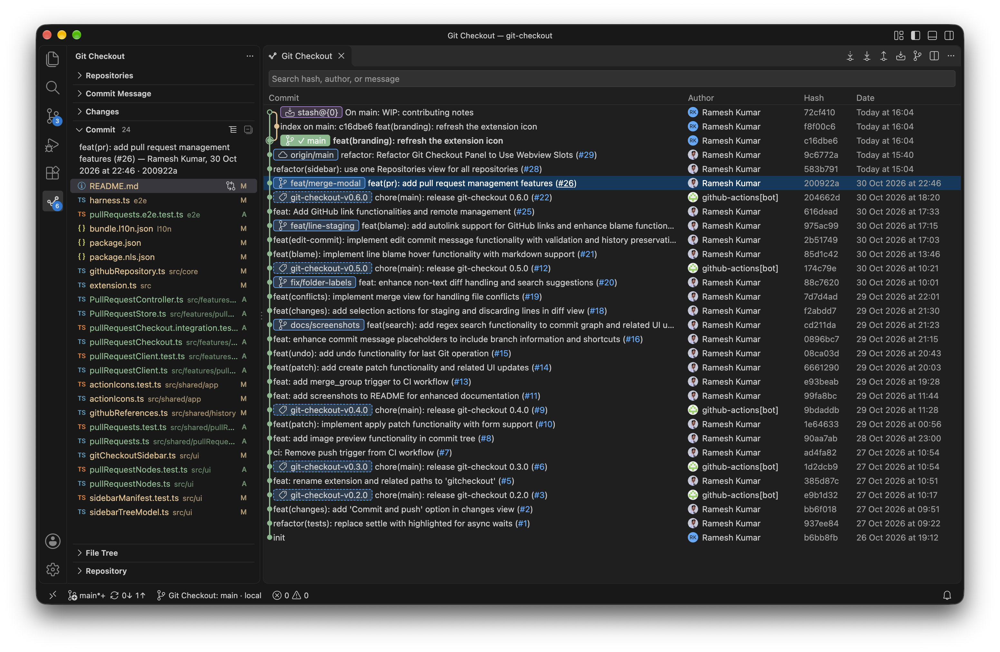
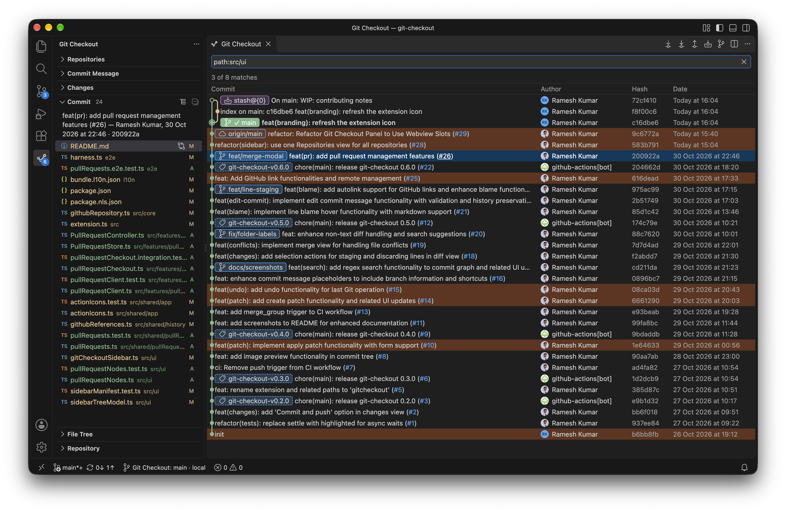
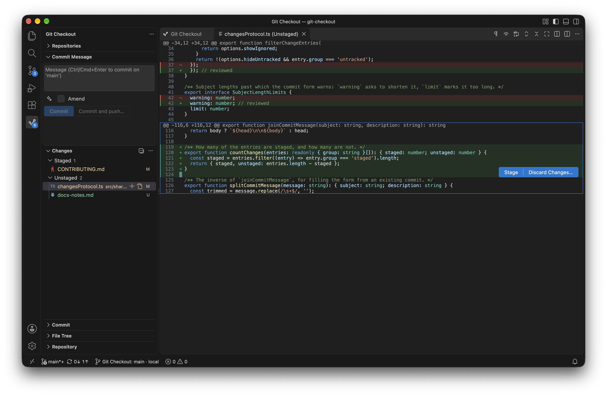
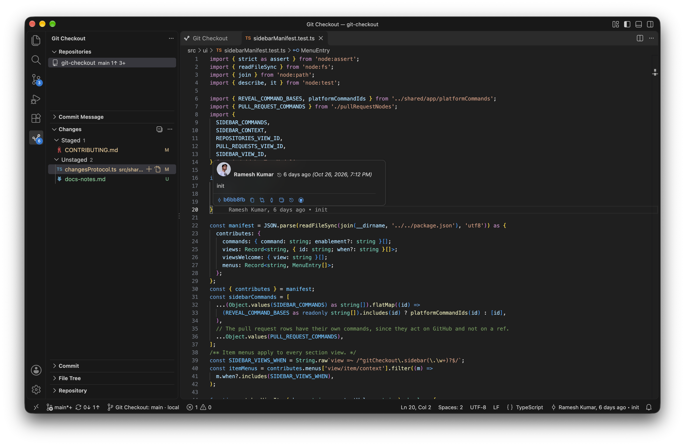
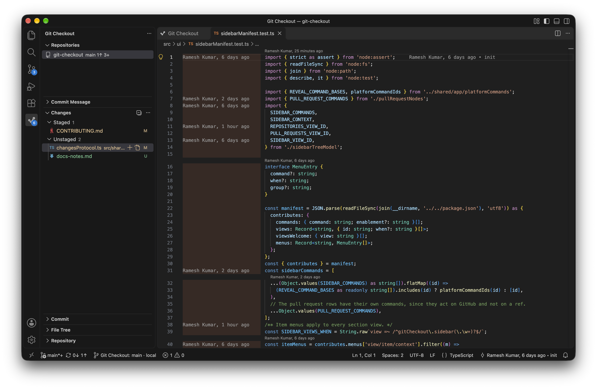
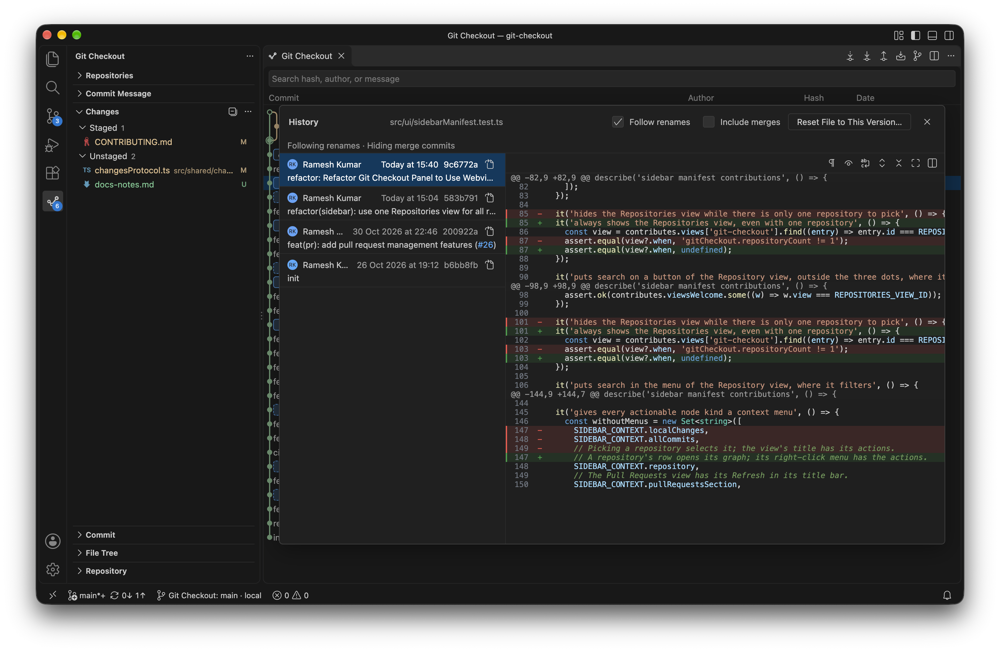
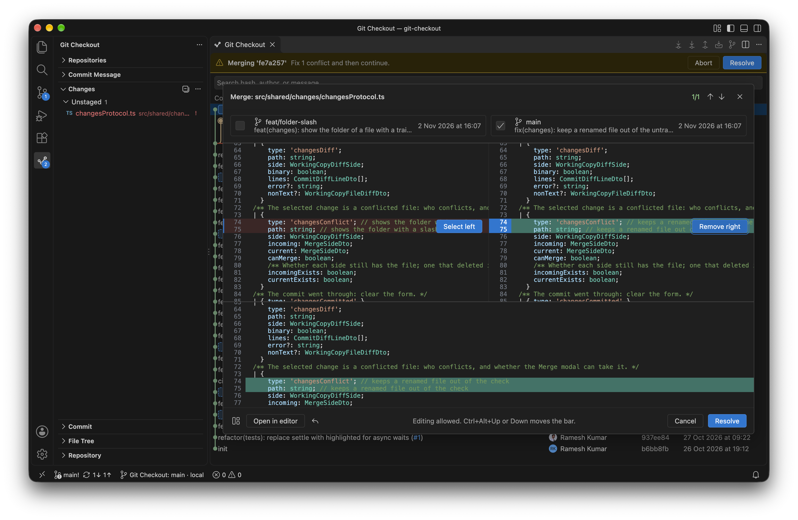
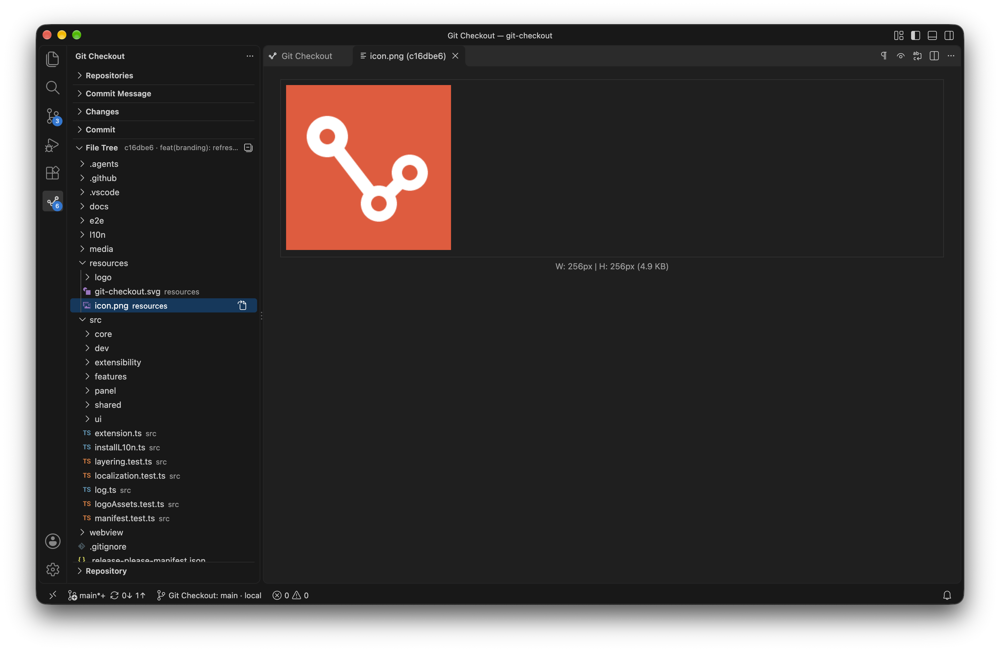
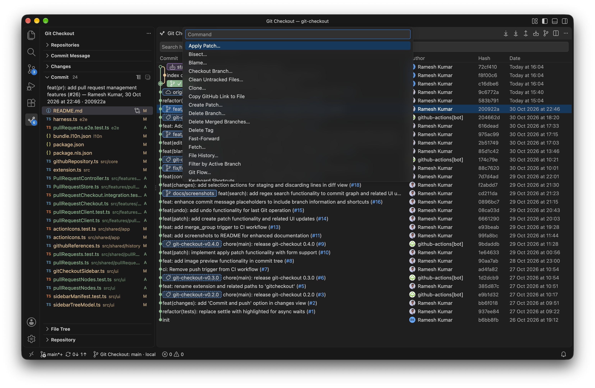

# Git Checkout

**A graphical Git client that lives in VS Code's sidebar.** See your history as a commit graph, stage the exact lines you mean, find out who changed what, and run branches, pull requests, stashes, worktrees, rebases and merges without leaving the editor. It looks and feels like VS Code, because it is made of VS Code's own views, menus and keys.

[Install from the Marketplace](https://marketplace.visualstudio.com/items?itemName=rkonit.gitcheckout) · [Report an issue](https://github.com/save-workspace-as/git-checkout/issues) · MIT license

## Get started in a minute

1. Install **Git Checkout** and open a folder that is a Git repository.
2. Click the **Git Checkout** icon in the Activity Bar. Your repositories, your changes and your branches are all in its sidebar.
3. Click a repository to open its commit graph in the main area, then click any commit to see the files it changed.
4. Press **Ctrl+P** (**Cmd+P** on macOS) while a Git Checkout view has focus to run any action from one list.

To clone, press **Ctrl+N** (**Cmd+Shift+N**), choose **Clone Repository…** in the empty sidebar, or run **Clone…** from Quick Launch.

## A sidebar for the whole repository

Everything sits in one container, top to bottom, and each part folds away. Anything that needs width, such as a diff, opens as a tab in the main area, like a file does.

| Section | What it holds |
| --- | --- |
| **Repositories** | Every repository of the workspace, with its branch and how far it is from its upstream. Pick one and all the sections below follow it. Right-click for fetch, pull, push, stash, undo, patches, settings and more. |
| **Commit Message** | The box you commit from, with Amend, Commit, Commit and push, a button that writes a message with AI, and one that has AI review the staged changes before you commit. |
| **Changes** | What is staged and what is not, as two groups. Click a file to open its diff. |
| **Commit** | The files the commit selected in the graph changed. |
| **File Tree** | The repository as it was at that commit, with a preview of any file. |
| **Repository** | Branches, remotes, tags, stashes, worktrees and submodules, each with its own right-click menu. A search filters all of them. |
| **Pull Requests** | The open pull requests of a GitHub repository, when there is one. |

## See your whole history

- **A graph you can read:** branches, tags, stashes and remote branches, with authors' pictures. Hide any of them, follow only the active branch, jump to HEAD, or show the reflog.
- **Search that understands Git:** words, or filters such as `author:ada`, `path:src/app.ts`, `since:2024-01-01`, `until:2024-06-30`, `content:text` (commits that add or remove that text) and `regex:pattern`.
- **Background fetch:** every open repository is fetched on a timer, so the graph shows what others pushed. It waits while a merge or rebase is under way, and it never asks for a password.
- **History tools:** file, folder and hunk history, cherry-pick, revert, reset, patches, archives of any commit, and bisect.

## Stage exactly what you mean

- **Files, hunks or single lines:** stage, unstage or discard a whole file, one hunk, or only the lines you select in the diff. Drag over them, or click line numbers, then press **S** to stage or **U** to unstage the selection. Selected lines can be stashed too, and part of a new file can be staged.
- **Fixup and squash:** stage some changes, right-click an earlier commit on the checked-out branch and choose **Fixup into This Commit…** to fold them into it, keeping its message, author and date. **Squash into Parent…** melts a commit into the one before it under a message you edit. Both replay the later commits, and warn when a remote branch already has the commit.
- **Split a commit:** right-click a commit on the checked-out branch and choose **Split Commit…**. The rebase stops at it with its changes unstaged, so you can stage parts (whole files, hunks or single lines), commit them one by one, and continue the rebase.
- **Branch from a stash:** right-click a stash in the graph and choose **Create Branch from Stash…** to start a branch at the commit the stash was made on, with the stash applied and dropped.
- **Compare a commit with something else:** right-click a commit and choose **Compare with HEAD**, **Compare with Merge Base**, **Compare with Upstream** (for a branch with an upstream), or **Compare with…** to pick a branch or tag. The changed files open in the Commit tab, as if the two commits were selected together.
- **Fast on large repositories:** in a repository with over 100 MB of objects and no commit-graph file with changed paths, Git Checkout writes one in the background, once per session. It is the file `git gc` writes, and it makes the graph, file history and blame several times faster. Turn it off with `gitCheckout.git.writeCommitGraph`.
- **Hide branches from the graph:** right-click a commit and choose **Branch**, then **Hide Branch**, to leave a branch, and the commits only it reaches, out of the graph. **Show Hidden Branches…** in the panel's menu brings them back. When a commit has several branches, you pick which one.
- **Explain a commit:** right-click a commit in the graph and choose **Explain Commit with AI**. A language model that VS Code provides, such as GitHub Copilot's, reads the message and the changes (a merge against its first parent) and opens a short Markdown explanation beside the graph.
- **AI features, on your terms:** commit messages, conflict resolution, pull request descriptions, commit explanations and staged-change reviews all use a language model that VS Code provides, and nothing is sent until you press one of their buttons. Turn them all off, and hide their buttons, with `gitCheckout.ai.enabled`. With `gitCheckout.ai.reviewConflictResolutions` on, each conflict resolution opens as a diff against the conflicted file and waits for you to accept it before it is written and staged.
- **Commit, amend, commit and push:** one box for the message, with a hint when the subject runs long.
- **Edit any commit's message:** right-click a commit and choose **Edit Commit Message…**. The commits after it are replayed with the same changes, authors and dates, and local changes are kept. It warns when a remote branch already has the commit.
- **Diffs that open like files:** each change opens in a tab, with options for whitespace, wrapping, context, full file and side by side in the tab's title bar.

## Know who changed every line

- **Inline and status bar blame:** who last changed the line you are on, in faint text at its end and in the status bar. Hover it for the commit message with its issues and pull requests linked, the author's picture, and quick actions: show the commit in the graph, copy its hash, open the change, see the line's history, or open it on GitHub.
- **File blame and CodeLens:** toggle a column that shows who changed each run of lines, tinted from warm for recent to cool for old. Optional CodeLens above a file, class or function says who changed it last.

- **Step back in time:** blame a line as it was before the change that last touched it. Commits listed in `.git-blame-ignore-revs`, such as a mass reformat, are skipped, as on GitHub.
- **Issue trackers:** `gitCheckout.autolinks` links `JIRA-123` style references in messages. The names match GitLens's, so those entries can be copied.
- **A whole file's story:** open the Blame view of a file from the File Tree, or its history (renames followed), from the right-click menu.

## Pull requests, without leaving the editor

- **A section in the sidebar:** for a repository on GitHub, **Pull Requests** groups your pull requests, and the ones you are asked to review, by what each needs next: *Ready to merge*, *Blocked* (conflicts or failed checks), *Requires follow-up* (changes requested), *Needs your review*, *Waiting for review* and *Draft*. *All open* lists every open pull request, with a badge for how their checks stand.
- **Check one out:** right-click a pull request to check it out (as the branch `pr/<number>`, through the same checkout as any branch), check it out in a worktree, review what it changes against its target branch, open it on GitHub, or copy its link.
- **Start one with a written description:** right-click a local branch and choose **Open Pull Request with AI Description…**. A language model that VS Code provides, such as GitHub Copilot's, writes the title and description from the branch's commits and changes, and GitHub's new pull request page opens with them filled in. Without a model, the page opens as it does without AI.
- **Quiet by default:** it uses your GitHub sign-in in VS Code, asks only for what a public repository needs and asks again for private ones, and can be turned off with `gitCheckout.pullRequests.enabled`.
- **Open on GitHub:** right-click a file for Open File on GitHub and Copy GitHub Link to File (to the selected lines), or a commit in the graph for Open Commit on GitHub. In the sidebar, **Open Remote in Browser** works for SSH and HTTPS remotes alike, and for hosts other than GitHub.

## Branches, tags, stashes, worktrees and submodules

- **Filter branches:** the filter button of the sidebar (or **Filter Branches…** on the Branches section) shows *Yours* (branches with commits of yours that the default branch lacks, found by your `user.email`), *Active* or *Stale* (changed within, or not for, three months). The sidebar and the graph list the same branches; the checked-out one always stays.
- **Branches, tags and remotes:** create, check out, rename, delete, merge, rebase, fast-forward, compare, and set upstreams.
- **Stashes:** save, apply, pop and drop.
- **Worktrees:** add, open and delete, or check a branch or pull request out into one.
- **Submodules:** add, initialize, update and sync.
- **Fetch, pull and push:** a form for the options, or Quick Fetch, Quick Pull and Quick Push for the tracked remote.

## Rebase and resolve with confidence

- **Interactive rebase:** reorder, squash, fix up, reword and drop commits.
- **A real merge view:** a conflicted file in the Changes list opens a Merge modal that shows the incoming and current sides next to the result. Take a side, the other or both for each conflict, or for all of them, or single lines by their numbers, or type the result. The same file also opens in VS Code's merge editor.

## Look at any commit, any file

- **File Tree:** browse the repository as it was at the selected commit, and preview any file, pictures included.
- **Image diffs:** the old and the new picture, side by side.
- **Quick Launch:** one list of every repository action, plus your own commands. Press **Ctrl+P** (**Cmd+P**).

## And the rest

- **Housekeeping:** prune stale remote-tracking branches, delete merged branches, clean untracked files, sparse checkout, garbage collection, and repository statistics, from Quick Launch.
- **Git Flow and commit signing.**
- **External diff and merge tools**, off until you turn them on.
- **Keyboard shortcuts** for every common action, which you can turn off or rebind.
- **Your own commands** in Quick Launch, with placeholders for the branch, file, URL and more.
- **Works anywhere your folder is:** Git Checkout runs on the workspace side, so Git always runs on the same machine as your folder: local, WSL, SSH, Dev Containers or Codespaces.

## Requirements

- VS Code 1.90 or newer.
- The built-in **Git** extension turned on. Do not set `git.enabled` to false; Git Checkout uses it for credentials and `git.path`.
- A Git installation on the machine that holds your folder.

## Settings

### Graph

| Setting | Default | What it does |
| --- | --- | --- |
| `gitCheckout.graph.order` | `date` | Commit order in the graph. |
| `gitCheckout.graph.showStashes` | on | Show stashes in the graph. |
| `gitCheckout.graph.showRemoteBranches` | on | Show remote-tracking branches in the graph. |
| `gitCheckout.graph.showTags` | on | Show tags in the graph. |
| `gitCheckout.graph.showReflog` | off | Show commits that only the reflog reaches. A repository can override this. |
| `gitCheckout.graph.compactBranchLabels` | on | Show a branch and its remote-tracking branches as one label. |
| `gitCheckout.graph.githubAvatars` | on | Show authors' GitHub profile pictures for repositories on GitHub. Asks github.com which account made a commit, once per author. |
| `gitCheckout.graph.gravatar` | off | Show Gravatar images for authors. This sends a hash of each author's email to gravatar.com. |

### Fetching and cloning

| Setting | Default | What it does |
| --- | --- | --- |
| `gitCheckout.autoFetch.enabled` | on | Fetch every open repository in the background. |
| `gitCheckout.autoFetch.intervalSeconds` | 180 | Seconds between background fetches (30 or more). |
| `gitCheckout.fetch.includeTags` | off | Fetch all tags on every fetch and auto-fetch. |
| `gitCheckout.clone.defaultFolder` | empty | Folder Clone Repository starts in. |
| `gitCheckout.network.timeoutMs` | 300000 | Timeout for fetch, pull and push. |

### Committing and branching

| Setting | Default | What it does |
| --- | --- | --- |
| `gitCheckout.commit.pushAfterCommit` | off | Push after every commit from the Changes view (not after an amend). |
| `gitCheckout.commit.subjectWarningLength` / `subjectLengthLimit` | 50 / 70 | Hint and mark when the commit subject is longer; 0 turns it off. |
| `gitCheckout.branch.rememberCheckout` | on | Create Branch remembers whether it last checked out the new branch. |
| `gitCheckout.branch.nameSeparator` | `/` | Separator used when a new branch name is prefilled from the current branch. |
| `gitCheckout.checkout.updateSubmodules` | on | Update submodules after a checkout. |
| `gitCheckout.leanBranching.stashOnSwitch` | off | Stash a dirty working tree before checkout or pull, and pop it afterward. |
| `gitCheckout.git.skipHooks` | off | Pass `--no-verify` to commit and push. |

### Diffs

| Setting | Default | What it does |
| --- | --- | --- |
| `gitCheckout.diff.syntaxHighlighting` / `changeMarks` | on / on | Color code in diffs; show + and − beside changed lines. |

### Blame and CodeLens

| Setting | Default | What it does |
| --- | --- | --- |
| `gitCheckout.blame.inline.enabled` | on | Show who last changed the cursor's line at its end, unless `git.blame.editorDecoration.enabled` is on. Turn it on or off with Toggle Inline Blame in Quick Launch. |
| `gitCheckout.blame.inline.format` | `{author}, {date} • {summary}` | What that text says. Use `{author}`, `{date}`, `{datetime}`, `{summary}` and `{hash}`. |
| `gitCheckout.blame.statusBar.enabled` | on | Show the same in the status bar. VS Code's Git extension has its own (`git.blame.statusBarItem.enabled`, on by default); while that is on, this one stays hidden so the status bar does not say it twice. |
| `gitCheckout.blame.hover.over` | annotation | Hover only the blame text, or anywhere on the line (`line`). |
| `gitCheckout.blame.file.format` | `{author}, {date}` | What the file blame column says for each run of lines. |
| `gitCheckout.codeLens.enabled` | off | Show the CodeLens for who changed a file, class or function last. |
| `gitCheckout.blame.ignoreRevs` | on | Leave the commits listed in the repository's `.git-blame-ignore-revs` file out of blame, so a bulk change such as a reformat does not hide who wrote the code. GitHub does the same. |

### GitHub and issue trackers

| Setting | Default | What it does |
| --- | --- | --- |
| `gitCheckout.pullRequests.enabled` | on | List the open pull requests of a GitHub repository in the sidebar. Turn it off to hide the section and stop asking GitHub. |
| `gitCheckout.autolinks` | empty | Links for an issue tracker's references in commit messages. Each entry has a `prefix` (`JIRA-`) and a `url` with `<num>` for the number (`https://jira.example.com/browse/JIRA-<num>`), and optionally `ignoreCase` and `alphanumeric`. The names match GitLens's `autolinks`, so those entries can be copied. Reopen the Git Checkout window after changing it. |

### Other

| Setting | Default | What it does |
| --- | --- | --- |
| `gitCheckout.shortcuts.enabled` | on | Turns the Git Checkout keyboard shortcuts on or off. |
| `gitCheckout.watch.debounceMs` | 200 | How long to coalesce Git file-watch events. |
| `gitCheckout.externalDiff.enabled`, `gitCheckout.externalMerge.enabled` | off | Allow the external diff and merge tools described below. |
| `gitCheckout.customCommands` | none | Your own commands for Quick Launch. |

## Extending

**Custom commands** (`gitCheckout.customCommands`) appear in **Git Checkout: Quick Launch** and **Git Checkout: Run Custom Command…**. Each entry has a `name`, a `context` (`branch`, `file`, `submodule`, or `url`), and a `command`. Placeholders are `${branch}`, `${file}`, `${submodule}`, `${url}`, `${repo}`, and `${sha}`. A `url` command that expands to `http` or `https` opens in the browser, which covers pull requests on forges without a built-in integration. Other commands run in the integrated terminal with the repository as the working directory, on the workspace host.

**External diff and merge** stay off so the editor remains the default. Enable `gitCheckout.externalDiff.enabled` or `gitCheckout.externalMerge.enabled`, then run **Git Checkout: Open External Diff** or **Git Checkout: Open External Merge**. Those commands run `git difftool` or `git mergetool` on the workspace host. Set `diff.tool` / `diff.guitool` or `merge.tool` / `merge.guitool` first. On Remote SSH, WSL, or Dev Containers the GUI tool must be installed on that host; a tool that exists only on your local machine will not open.

**Gitignore:** **Git Checkout: Add .gitignore Template…** appends a built-in template to the repository `.gitignore`. **Git Checkout: Add to .gitignore** appends the Explorer selection, or a pattern you type.

## Keyboard shortcuts

While a Git Checkout window, its sidebar or one of its tabs has focus, these shortcuts work. On macOS use the second column.

| Windows and Linux | macOS | Action |
| --- | --- | --- |
| Ctrl+1 | Cmd+1 | Show Changes; pressed again, focus the commit message |
| Ctrl+2 | Cmd+2 | Show all commits; pressed again, jump to HEAD |
| Ctrl+0 | Cmd+0 | Reveal HEAD in the graph |
| Ctrl+P | Cmd+P | Quick Launch |
| Ctrl+F | Cmd+F | Search commits |
| F3, Shift+F3 | F3, Shift+F3 | Next, previous search result (Enter and Shift+Enter in the search field) |
| Ctrl+C | Cmd+C | Copy the selected commit's hash (in the Changes lists, the file path) |
| Delete | Backspace | Remove the selected commit's branch or stash (also in the sidebar) |
| Ctrl+Shift+A | Cmd+Shift+A | Filter the graph by the active branch |
| Ctrl+Enter | Cmd+Enter | Commit |
| Ctrl+Shift+Enter | Cmd+Shift+Enter | Commit and push |
| Ctrl+Shift+S | Cmd+S | Stage or unstage the selected files |
| Ctrl+Alt+Shift+S | Cmd+Alt+Shift+S | Stage all |
| Backspace, Ctrl+Shift+D | Backspace, Cmd+Shift+D | Discard the selected files |
| Ctrl+O | Cmd+Alt+Shift+O | Open the selected file |
| Ctrl+D | Cmd+D | Open the selected file in the external diff tool |
| F5 | Cmd+R | Refresh |
| Ctrl+N | Cmd+Shift+N | Clone a repository |
| Ctrl+Shift+N | Ctrl+Shift+N | Initialize a repository |
| Ctrl+O | Cmd+O | Open a repository |
| Ctrl+B | Cmd+B | Checkout a branch |
| Ctrl+Shift+F | Cmd+Shift+F | Fetch |
| Ctrl+Alt+Shift+F | Cmd+Alt+Shift+F | Quick Fetch: the tracked remote, no form |
| Ctrl+Shift+L | Cmd+Shift+L | Pull |
| Ctrl+Alt+Shift+L | Cmd+Alt+Shift+L | Quick Pull |
| Ctrl+Shift+P | Cmd+Shift+P | Push |
| Ctrl+Alt+Shift+P | Cmd+Alt+Shift+P | Quick Push |
| Ctrl+Shift+B | Cmd+Shift+B | New branch |
| Ctrl+Shift+T | Cmd+Shift+T | New tag |
| Ctrl+Shift+H | Cmd+Shift+H | Save stash |
| Ctrl+Alt+Shift+H | Cmd+Alt+Shift+H | Quick Stash: stash everything, no form |
| Ctrl+Alt+O | Cmd+Ctrl+O | Reveal the repository in the file manager |
| Ctrl+Alt+T | Cmd+Ctrl+T | Open the repository in a terminal |

Tabs, Zoom and Preferences (Ctrl+Tab, Ctrl+W, Ctrl+=, Ctrl+-, Ctrl+,) are VS Code's own and work as usual.

Outside those places VS Code's own keys (such as Ctrl+B, Ctrl+N and Ctrl+O) are untouched. To turn all of them off, clear
`gitCheckout.shortcuts.enabled`. To change one, run **Git Checkout: Keyboard Shortcuts** from the Command Palette. It opens VS Code's Keyboard
Shortcuts editor filtered to this extension, where you can rebind or remove any of them like any other shortcut.

## Remote workspaces

Git Checkout is a workspace extension. On WSL, SSH, Dev Containers and Codespaces it runs on the remote machine, so Git, the folder picker and the clone destination are all on that machine. Quick Launch words its Reveal action neutrally ("Reveal in File Manager") in a remote window.

### Git path

Git Checkout runs git with `api.git.path` from `vscode.git` on the workspace host. A Windows drive-letter or UNC path is used only when that host is Windows. On WSL, Linux SSH, and a Linux Dev Container, that path is ignored, commands stay unavailable, and the Git Checkout output explains why.

Confirm the host:

1. **Developer: Show Running Extensions** lists **Git Checkout** (`rkonit.gitcheckout`) on the **remote** host, with extension kind **workspace**.
2. **Git Checkout: Show Output**, or the status-bar tooltip, shows `remote`, `extension kind`, and `git.path`. `git.path` must be a binary on that host.

If `git.path` is `(unavailable)` and the output mentions a Windows path, `vscode.git` reported your local Windows git. On the remote, set `git.path` to that host's git (or clear the User value) and reload the window.

## Privacy

This extension does not collect telemetry. The only requests it makes on its own are for authors' pictures: for a repository on GitHub it asks github.com which account made a commit, once per author, and loads that account's picture (turn off with `gitCheckout.graph.githubAvatars`); and it loads Gravatar images when `gitCheckout.graph.gravatar` is on. The Pull Requests section asks api.github.com for the open pull requests of the repository, with your GitHub sign-in in VS Code, when the sidebar shows (turn off with `gitCheckout.pullRequests.enabled`). Background fetch talks only to your own remotes.

## Contributing

Build and test instructions are in [CONTRIBUTING.md](CONTRIBUTING.md). Open and planned work is in the [GitHub issues](https://github.com/save-workspace-as/git-checkout/issues).

## License

MIT
